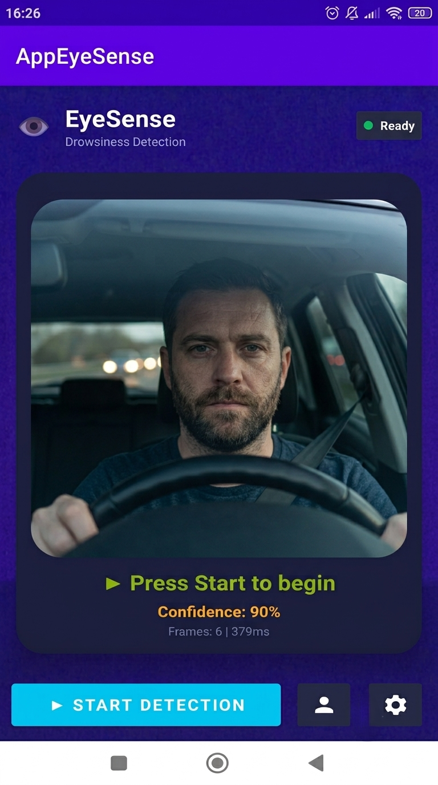
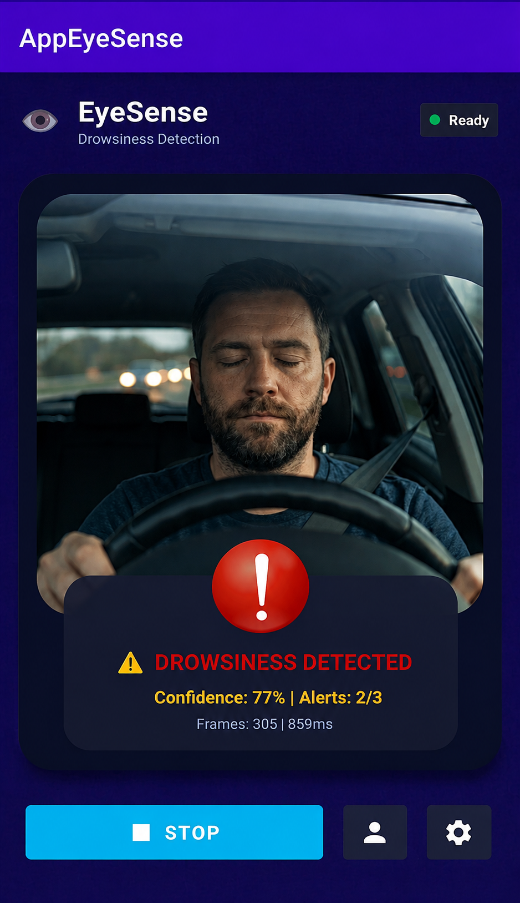
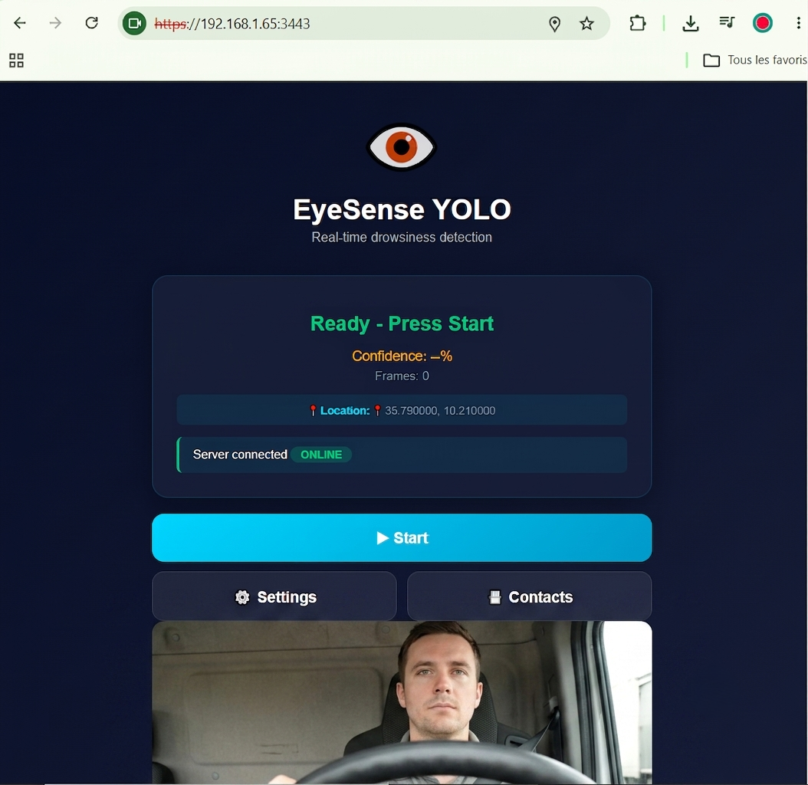

# 👁️ EyeSense - Drowsiness Detection

A real-time drowsiness detection system for drivers, combining an Android mobile application and a web application.

---

## 📖 Table of Contents

- [About](#-about)
- [Features](#-features)
- [Technologies](#-technologies)
- [Prerequisites](#-prerequisites)
- [Installation](#-installation)
- [Usage](#-usage)
- [Performance](#-performance)
- [Author](#-author)
- [License](#-license)

---

## 📌 About

Drowsy driving is one of the leading causes of road accidents worldwide. **EyeSense** is a complete solution that detects signs of driver fatigue in real time using artificial intelligence.

The project is built on the **YOLO26n** model for eye and mouth detection, and comes as two independent applications:

- **Android mobile app**: offline detection using TensorFlow Lite
- **Web app**: remote detection through an AI server

---

## ✨ Features

### Mobile app (Android)
- 📷 Real-time detection via the front camera
- 🧠 On-device inference with TensorFlow Lite (works offline)
- 🔊 Audible and visual alerts
- 📧 Alert emails with GPS location
- 📇 Emergency contact management
- 🌙 Night mode for night driving

<p align="center">
  
</p>
<p align="center">
  
</p>


### Web app
- 🌐 Accessible from any browser
- 📷 Video capture via WebRTC
- 🧠 Remote inference through an AI server
- 📧 Multi-channel alert system

<p align="center">
  
</p>
<p align="center">
  
</p>

---

## 🛠️ Technologies

| Component | Technologies |
|---|---|
| **Artificial Intelligence** | YOLO26n, PyTorch, Ultralytics, TensorFlow Lite |
| **Mobile app** | Java, Android Studio, CameraX, Gson |
| **Web app** | HTML5, CSS3, JavaScript, Node.js, Express, Flask |

---

## ⚙️ Prerequisites

### Mobile app
- Android Studio
- Android SDK (minSdk 24, targetSdk 36)
- Android smartphone with a front camera

### Web app
- Node.js >= 18.0
- Python >= 3.10
- npm or yarn

---

## 🚀 Installation

### Mobile app

```bash
# 1. Open the project with Android Studio
cd app_mobile

# 2. Build and install the APK
# Connect a smartphone with USB debugging enabled
# Click "Run" in Android Studio
```

### Web app

```bash
# 1. Start the AI server (Python / Flask)
cd ia
pip install -r requirements.txt
python yolo_server.py

# 2. Start the web server (Node.js) in another terminal
cd ../app_web
npm install
npm start
```

---

## 🎯 Usage

### Mobile app

1. Open the EyeSense app on your smartphone
2. Allow access to the camera and location
3. Tap **"Start"** to begin detection
4. When drowsiness is detected, an alert is triggered

### Web app

1. Open <https://localhost:3443> in a browser
   > ⚠️ The certificate is self-signed, so the browser may show a warning: accept it to continue. HTTPS is required for camera access via WebRTC.
2. Allow camera access
3. Click **"Start"** to begin detection
4. When drowsiness is detected, an audible alert is played

---

## 📊 Performance

| Metric | Value |
|---|---|
| Accuracy | 98.53 % |
| Precision | 97.8 % |
| Recall | 98.6 % |
| mAP50 | 99.2 % |
| TFLite size (float32) | 9.27 MB |
| TFLite size (float16) | 4.72 MB |
| Mobile latency | ~125 ms |

---

## 👩‍💻 Author

**Rimeh ABIDI**

📧 Email: [rimeh.abidi@enis.tn](mailto:rimeh.abidi@enis.tn)
🔗 GitHub: [github.com/abidirymeh](https://github.com/abidirymeh)

---

## 📄 License

This project is licensed under the **MIT License**. See the [LICENSE](LICENSE) file for details.
